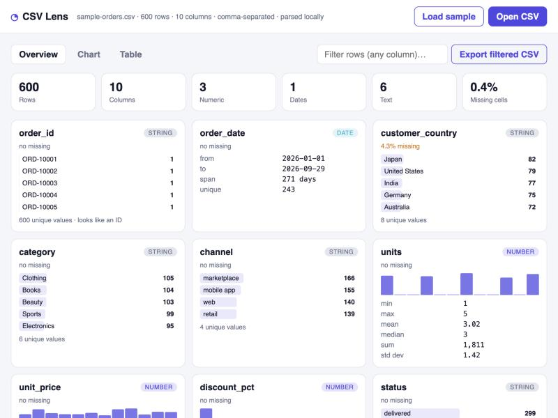
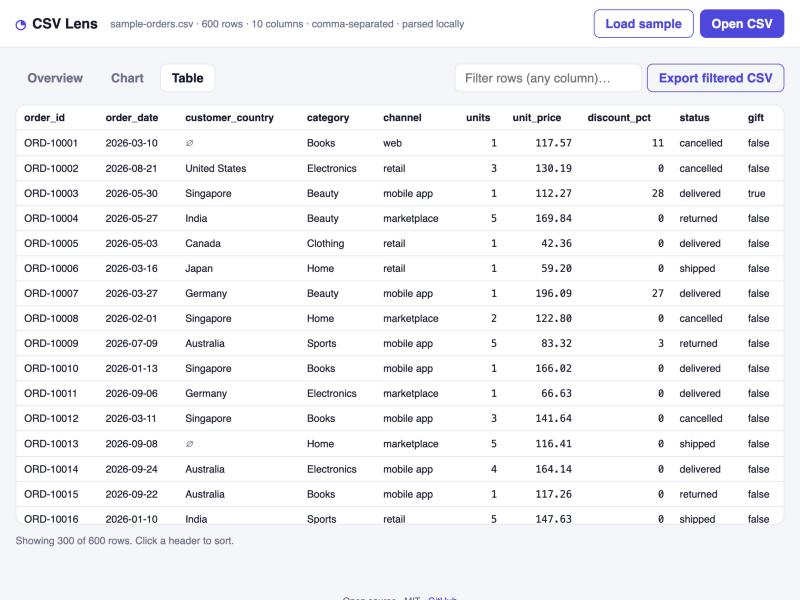

# ◔ CSV Lens

**Drop a CSV, get a dashboard. Runs entirely in your browser; nothing is uploaded.**

Live: **https://shivanicc.github.io/csv-lens/**



## Why

You get a CSV export from Shopify, HubSpot, your bank, a survey tool, a database. You want a quick look: what's in here, what's missing, how does it trend. Your options are opening Excel, or uploading the file to some website. CSV Lens is the third option: open a page, drop the file, and read it. The file is parsed with JavaScript in your tab and never leaves your machine, so it's safe for customer data, financials, anything.

## What it does

- **Detects the delimiter** (comma, tab, semicolon, pipe) and parses RFC 4180 CSV properly: quoted fields, escaped quotes, newlines inside quotes, BOMs.
- **Infers column types**: number (including `$1,200.50` and `12%`), date (ISO, US, long form), boolean, text, empty.
- **Overview**: row and column counts, missing-cell rate, and a card per column. Numbers get min / max / mean / median / sum / standard deviation and a histogram. Dates get the range and span. Text gets the top values with share bars, unique count, and an "looks like an ID" hint.
- **Chart builder**: group by any text or date column (by day / month / year), measure count or sum / average / min / max of any numeric column, as bar, line, or doughnut. Top 20 groups for high-cardinality columns.
- **Table**: sortable by any column (numeric and date aware), with missing values marked, first 300 rows rendered.
- **Filter**: one search box filters rows across every column. The chart and the table both follow the filter.
- **Export** the filtered rows as a clean CSV.
- Light and dark mode. No build step, no accounts, no dependencies except Chart.js for drawing.



## Run it

It's static files. Either open `index.html` directly, or:

```bash
python3 -m http.server 8000
# open http://localhost:8000/
```

Click **Load sample** to try it with a 600-row e-commerce orders dataset, or drop your own file.

## How it's built

- `csv.js` — the engine, with no DOM dependency: a state-machine CSV parser, delimiter detection by column-count consistency, type inference on a sample of each column, column statistics (quantiles, histogram, top values), group-by aggregation with date bucketing, and a CSV serializer. It also runs under Node, which is how the unit checks are done.
- `app.js` — the UI: loading (file picker, drag and drop, sample), filtering and sorting, the overview cards, the chart builder (Chart.js), the table, and export.
- `sample.js` — a deterministic sample dataset generated from a seeded PRNG, so the demo is reproducible.
- `style.css` — layout and theming with CSS variables.

Large files: type inference and stats run on the full column but sample down for inference above 2,000 values, and the table renders 300 rows at a time, so files in the hundreds of thousands of rows stay responsive.

## Credits

Written by Shivani Chauhan. Chart.js (MIT) for rendering charts. Claude Code was used as a pair-programming assistant while building.

## License

MIT
